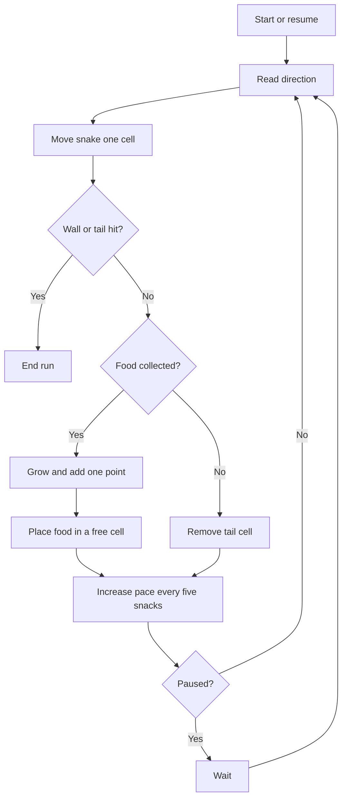

# Snake — Afterhours Arcade

A polished, responsive take on classic Snake, built with Vue 3, TypeScript, and Vite. No account, download, or backend required.

**Play it:** [oscarmmi.github.io/snake](https://oscarmmi.github.io/snake/)

## How to play

- Press **Start Game** or use the arrow keys / **WASD** to begin moving.
- Collect the amber snacks to grow and earn one point per snack. The pace increases every five snacks.
- Avoid the walls and your own tail. Either ends the run.
- Use **Space** to pause or resume and **R** to start a new run.
- On touchscreens, swipe on the board or use the directional pad below it.
- Your personal best is saved locally in this browser.

## Run locally

```sh
npm install
npm run dev
```

Run the pure game-logic tests and production build:

```sh
npm test
npm run build
```

## Game loop



## Deployment

GitHub Actions builds the app and deploys `dist/` to GitHub Pages on every push to `main`.
